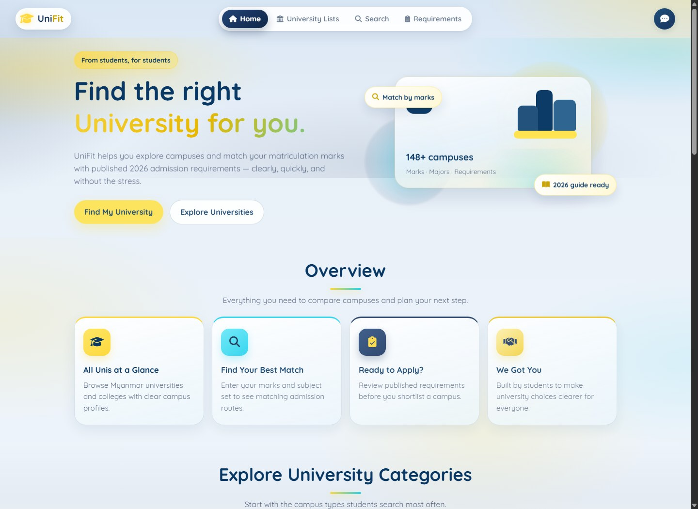
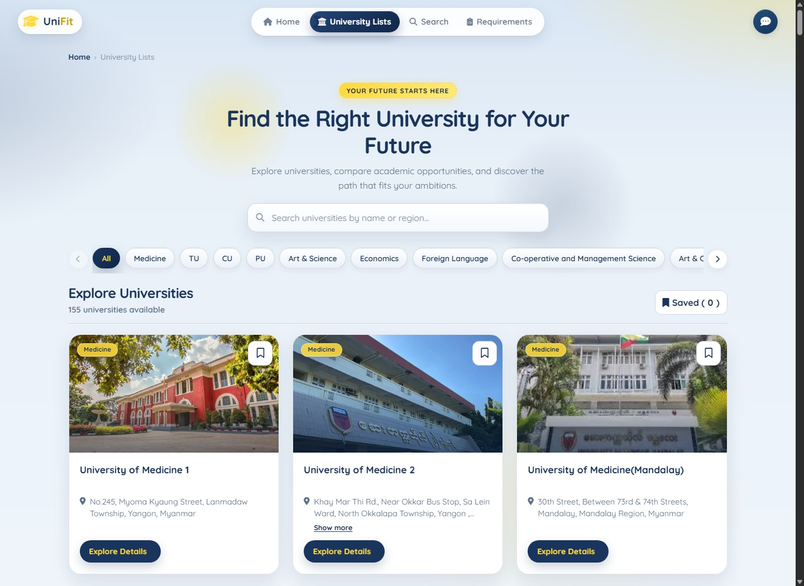
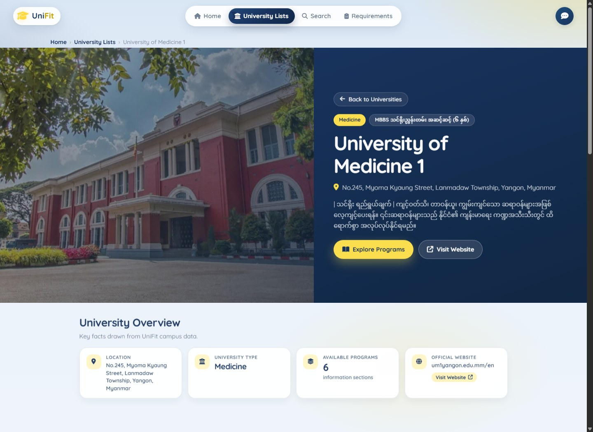
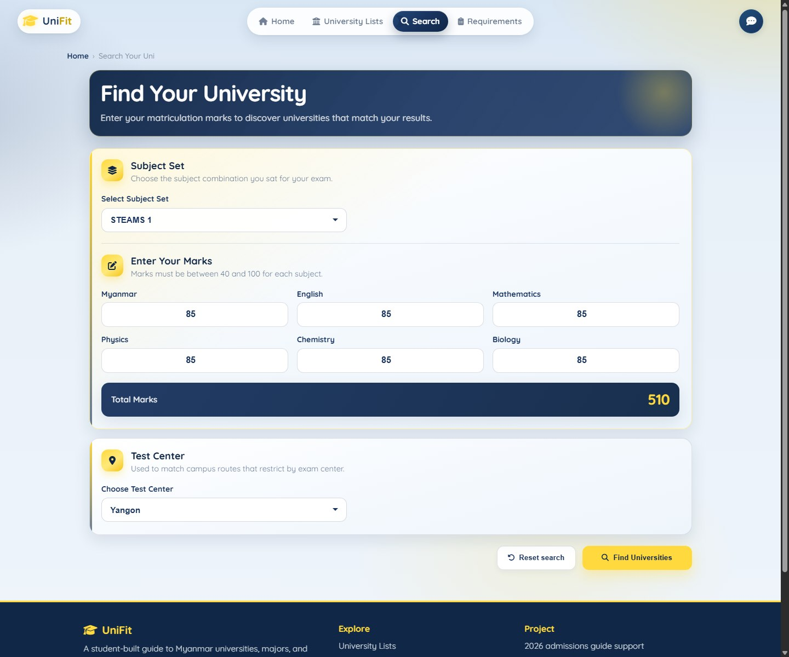
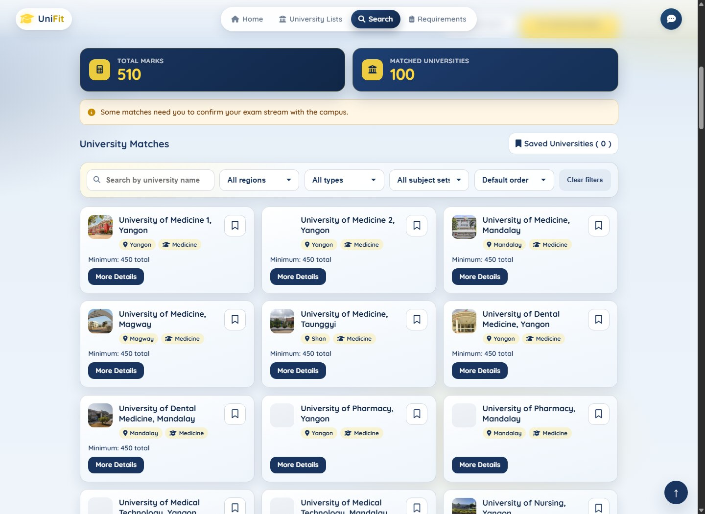
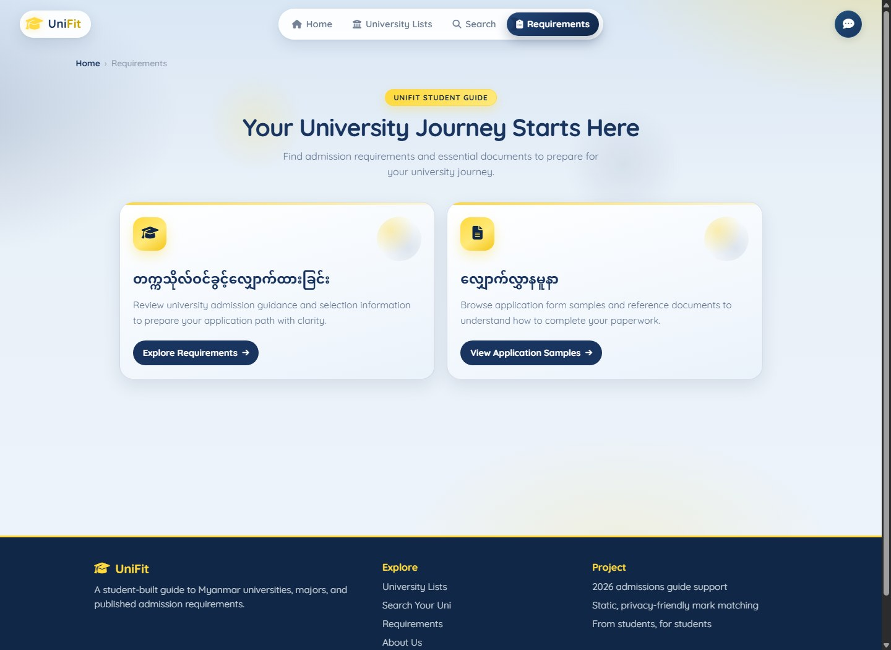
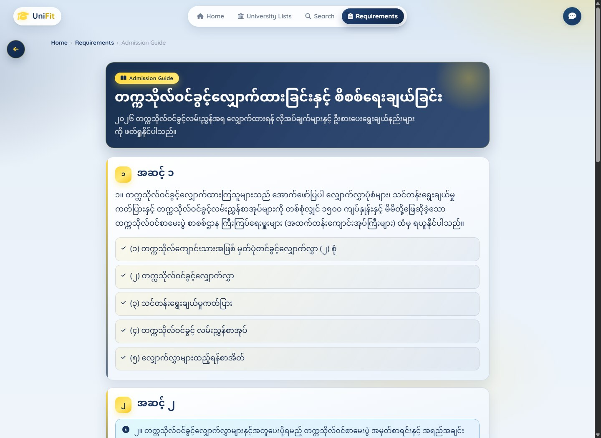
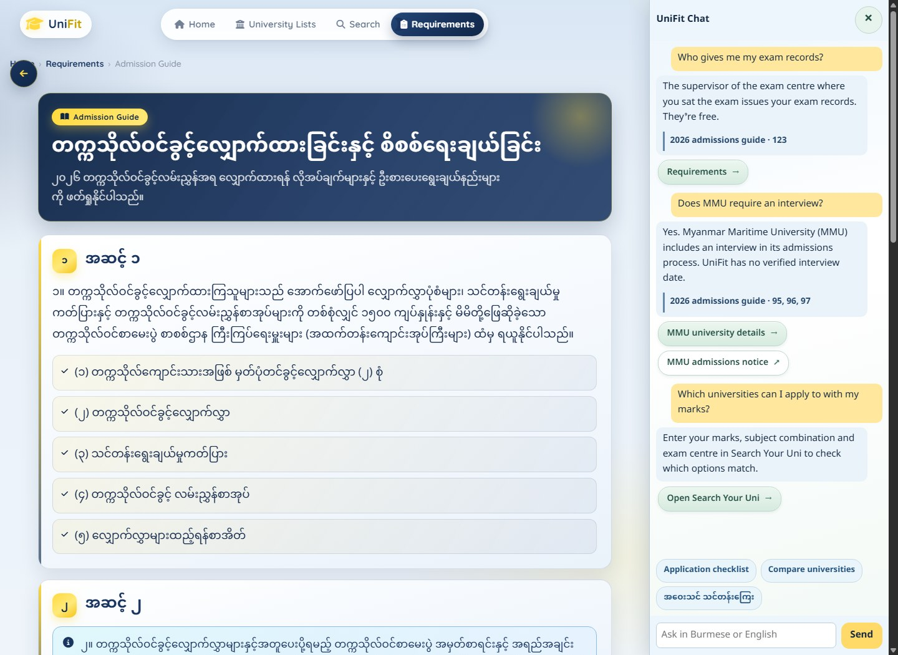

# UniFit

UniFit helps students in Myanmar explore universities and colleges, check published 2026 admission requirements, and decide where to apply.

## Explore UniFit

### Home



### University Lists

Browse campuses by category or search by name. You can search within a selected category, then open a university profile to see its majors, descriptions, images, and available website link. The profile has one admissions section for the university. Returning to the list takes you back to your previous filters and position.



### University profile



### Search Your Uni

Choose your matriculation subject set to reveal the marks fields. Enter your marks and select your exam centre to see programmes that match the published criteria. Use **More Details** to open the university's admissions section. A match is guidance for applying. Final admission decisions are made by the university.

Example search using STEAMS 1, 85 marks in each subject, and a Yangon exam centre.





### Saved universities

Save universities as you browse and revisit them from the saved-universities shortcut. UniFit stores the shortlist in your browser, so it stays on the device and browser you used to save it.

### Requirements

The [Requirements page](req1.html) explains the application process, including the forms and exam records students need to prepare.





### UniFit Chat

Open the chat from the navigation icon and ask in Burmese or English. It opens alongside the page on desktop and fills the screen on mobile. Try questions like these:

- What documents do I need to apply?
- Compare computing entry requirements at UCSY, UCSM, and NSPU.
- အဝေးသင် သင်တန်းကြေး ဘယ်လောက်လဲ။

Chat can link to university profiles, the Requirements page, or Search Your Uni. When a question has a verified answer in UniFit's data, replies can cite the relevant guide pages. Historical admitted scores may be unavailable.



## How it works

### Admissions matching

The search page applies published criteria using the selected subject set, marks, and exam centre. Some routes use a total score, while others use specific subjects, score combinations, or regional conditions. Where a stream restriction is still unconfirmed, UniFit asks students to confirm it with the university.

### Chat answers

The browser sends questions to the Python endpoint at `/api/chat`. The server looks up reviewed records in SQLite and can use Gemini for questions that need a model response. The Gemini key is stored on the server.

## Tech stack

- **Frontend** — HTML, CSS, and JavaScript
- **Data** — SQLite and generated JSON files
- **Chat** — Python and Gemini API
- **Deployment** — Vercel static site and Python Function

## Repository layout

| Location | Contents |
| --- | --- |
| `universities/` | University profile pages |
| `assets/` | Stylesheets, JavaScript, and images |
| `data/` | Generated university, admissions, and profile data |
| `maintenance/` | SQLite database, exporter, link checker, and maintenance guide |
| `api/chat.py` | Vercel entry point for chat |
| `vercel.json` | Vercel build and function configuration |

## Run locally

Open the repository folder in VS Code and run the command for the features you want to try.

### Website preview

```powershell
python -m http.server 8082 --bind 127.0.0.1
```

Keep the terminal open and visit [the website preview](http://127.0.0.1:8082/). The website uses the generated data included in the repo.

### Chat preview

```powershell
python maintenance/serve-chat.py --port 8084
```

Visit [the chat preview](http://127.0.0.1:8084/) and click the chat icon. SQLite lookup works without a Gemini key. To enable Gemini, put `GEMINI_API_KEY` in the Git-ignored local `.env` file or set it in the server environment before starting the preview.

## Maintain and deploy

Open `maintenance/unifit.sqlite` in DBeaver with a SQLite connection. After saving a reviewed data update, regenerate the site files and check links:

```powershell
python maintenance/export-site.py
python maintenance/check-links.py
```

For deployment, import the GitHub repository into Vercel and use the checked-in configuration. Set `GEMINI_API_KEY` as a sensitive environment variable for the deployment that should use Gemini. See the [maintenance guide](maintenance/README.md) for deployment verification, database tables, and sample queries.
